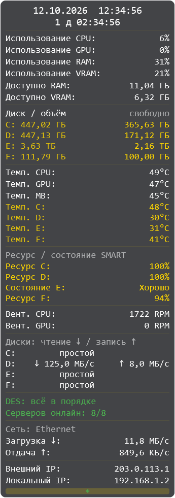

# DES OSD Panel

Компактный мониторинговый виджет для Windows (WPF, .NET 8): вертикальная полупрозрачная панель, всегда на экране.

Публичная копия исходников для репозитория `DES-OSD-Panel-public`. Разработка ведётся с помощью ИИ-агентов; решения о функциях и проверка удобства использования выполняются владельцем проекта.

## Лицензия и данные

Собственный код проекта распространяется по [MIT](LICENSE). Зависимости сохраняют свои лицензии: LibreHardwareMonitorLib — MPL-2.0; ссылки на исходники и условия приведены в [THIRD-PARTY-NOTICES.md](THIRD-PARTY-NOTICES.md).

В копию не включены история частного репозитория, пользовательские настройки, реальные отчёты датчиков и сборки. Иллюстрации создаются на примерных данных. Значения SMART для отдельных моделей — профили совместимости, а не идентификаторы конкретных экземпляров накопителей.

При включённом разделе IP приложение обращается по HTTPS к `api.ipify.org`, чтобы узнать внешний IP. Этот сервис видит IP запроса. Раздел можно отключить в настройках. Другие сетевые показатели читаются локально. Необязательная интеграция DES Control Center читает локальные файлы; без установленного Control Center её можно отключить.

Настройки хранятся в `%AppData%\OsdPanel\settings.json`. Копии приложения используют один путь настроек и одинаковые горячие клавиши: запускайте одну копию за раз. Для сборки и запуска нужна Windows; датчики зависят от поддержки оборудования библиотекой.



## Что показывает

- Дата и время
- Время работы Windows с момента старта системы, по центру под датой; после суток отображается также число дней.
- Использование CPU / GPU, %
- Использование RAM / VRAM, %
- Доступно RAM и VRAM в гигабайтах с двумя знаками после запятой; эти строки можно отдельно отключить в настройках.
- Ёмкость и свободное место фиксированных дисков
- В строках дисков слева указаны буква и полная ёмкость, справа — свободное место; гигабайты и терабайты выводятся с двумя знаками после запятой.
- Температуры: CPU, GPU, материнская плата, диски
- Остаточный ресурс SSD и состояние HDD по SMART (отдельный отключаемый раздел, обновление раз в минуту).
- Обороты вентиляторов: CPU, GPU
- Скорость чтения и записи каждого физического накопителя, в байтах/с, КБ/с, МБ/с или ГБ/с; при нулевых счётчиках — «простой»
- Скорость загрузки и отдачи выбранного сетевого адаптера
- Локальный IPv4-адрес выбранного адаптера и внешний IP
- Статус DES Control Center и число серверов онлайн из локального экспорта (отдельный отключаемый блок внизу).

Температуры, активность и SMART сопоставляются по физическому номеру устройства с текущими связями Windows `Win32_LogicalDiskToPartition`. Связи обновляются не реже раза в 5 секунд и сразу при изменении списка букв: сохранённые при запуске `AbstractStorage.DriveInfos` не используются как источник текущих букв. При ошибке чтения связей привязка очищается, чтобы не показать показания другого диска. Если один физический накопитель содержит несколько букв, его показания относятся ко всему устройству. Неоднозначные или недоступные данные отображаются как `—`.

Для SMART A9 поддержаны подтверждённые по CrystalDiskInfo сочетания модели/прошивки: `SSD / HPS2227I` и `ADATA SU650 / XD0R630B`. Для этих двух профилей используется нормализованное текущее значение A9 (остаточный ресурс 0–100). Для `AMD R5M120G8 / V0718B0` используется RAW A9: проверено по CrystalDiskInfo (RAW 0x5E = 94 %, при нормализованном значении 100). Универсальное поле Windows Wear не используется. Для остальных форматов A9 процент не угадывается. Остаток ≤10 % выделяется оранжевым, 0 % или нарушение нормализованного порога SMART — красным. Для `TOSHIBA HDWT740` состояние учитывает пороги SMART и RAW 05/C5/C6; «Хорошо» требует доступности этих атрибутов и таблицы порогов, ненулевые счётчики дают «Внимание». Процент для HDD не рассчитывается. Это мониторинг SMART, а не гарантия от отказа.

Датчики читаются через [LibreHardwareMonitorLib](https://www.nuget.org/packages/LibreHardwareMonitorLib). Недоступные датчики отображаются как `—` (часть датчиков требует запуск от администратора).

## Поведение окна

### Игровая строка

`Ctrl+Alt+G` показывает и скрывает отдельную строку поверх окон: CPU, GPU, RAM, VRAM в процентах, температуры CPU и GPU. Она начинает работу скрытой, имеет собственное окно и не зависит от видимости или режима «поверх всех окон» основной панели. Команда также доступна в меню трея.

Вся строка салатовая (`#ADFF2F`); значение температуры CPU или GPU становится красным при достижении критического порога из настроек. Оранжевый уровень основной панели к строке не применяется. Недоступные датчики показываются как `—`.

Под значения зарезервированы постоянные позиции моноширинного шрифта: до трёх цифр и `%` либо `°C`. Переходы 9 → 10 → 100 и временная недоступность датчика не меняют ширину строки и не сдвигают разделители.

Строка не активирует окно и обычно пропускает клики. Чтобы переместить её, удерживайте **Ctrl+Alt** и перетаскивайте левой кнопкой мыши. Позиция сохраняется отдельно от панели; можно переносить между мониторами. Размер шрифта и плотность фона берутся из настроек панели; при недостатке ширины строка уменьшается до ширины монитора. Повтор клавиш при удержании `G` отключён. Если регистрация сочетания не удалась, в трее показывается уведомление и остаётся доступной команда меню.

Это обычное окно Windows поверх других окон. Работа в конкретных играх, в том числе в эксклюзивном полноэкранном режиме и с ограничениями на оверлеи, требует проверки; для оконного режима/режима без рамки не требуется внедрение в процесс игры.

### DES Control Center

Панель читает только `%AppData%/DesControlCenter/status-line.txt` и `status.json`, без сетевых запросов к серверам DES. Опрос — раз в 3 секунды (при интервале панели больше 3 секунд — на ближайшем опросе панели). JSON определяет состояние, счётчики и актуальность; строка TXT переиспользуется только при согласованности с JSON. Если TXT отсутствует, подпись строится из JSON.

Нормальный статус зелёный, проблемы/недоступные серверы красные, предупреждения/приглушённые проблемы/ожидание проверки оранжевые. `running=false` означает «DES не запущен». Возраст `updatedAt` более 3 минут означает «DES: данные устарели»; время сравнивается с учётом часового пояса. Некорректный JSON, отсутствие файла или недоступность чтения показываются нейтральным «DES: статус недоступен», без сохранения прежнего зелёного статуса. Отсутствующие/некорректные обязательные поля также не считаются нормой. Настройка: «Статус DES Control Center».

### Окно и размещение

- Панель можно переносить между мониторами за нижнюю полосу. При отпускании она остаётся в рабочей области текущего монитора; двойной клик прилипает к его ближайшему углу. Поддерживаются экраны слева/выше основного и разный масштаб DPI.
- Положение сохраняется также в физических пикселях, чтобы восстановить панель на выбранном мониторе. Если монитор отключён, панель возвращается в рабочую область ближайшего доступного экрана.
- Значок приложения и трея — синий круг на прозрачном фоне.
- Через меню трея → «Настройки…» доступны размер шрифта 12–30, плотность фона 20–100 %, интервал 500–5000 мс, выбор сетевого адаптера, видимость разделов и цветовые пороги. Изменения применяются сразу и сохраняются; «Отмена» ничего не меняет.
- Пороги температуры задаются отдельно для CPU, GPU, платы и каждой буквы диска; пороги свободного места — для каждого диска в процентах. Предупреждение оранжевое, критический порог красный. Исходные значения — настраиваемые предпочтения, а не паспортные ограничения оборудования.
- «Закрепить положение» в трее блокирует перетаскивание. Если содержимое не помещается по высоте, появляется полоса прокрутки справа; она принимает клики, остальные строки продолжают пропускать их насквозь.
- Панель пропускает клики насквозь (`WS_EX_TRANSPARENT | WS_EX_LAYERED`).
- Тонкая полоса внизу панели — зона захвата: при наведении клики включаются, панель можно перетаскивать; двойной клик — прилипание к ближайшему углу экрана.
- `Ctrl+Alt+O` — вкл/выкл «поверх всех окон» (индикатор — точка в полосе внизу; зелёная = вкл). Дублируется пунктом в трее.
- Закрытие окна сворачивает приложение в трей; выход — только через меню трея.
- Позиция окна и флаг TopMost сохраняются в `%AppData%\OsdPanel\settings.json`.

## Сборка и запуск

Требуется Windows и .NET 8 SDK (для запуска сборки — .NET 8 Desktop Runtime).

```powershell
dotnet restore
dotnet build .\OsdPanel\OsdPanel.csproj -c Release -o release
# запуск:
.\release\OsdPanel.exe
```

## Автозапуск с правами администратора

Новая сборка находится в `release\OsdPanel.exe`. Основной шрифт — 18, часы — 19,5; ширина панели — 345.

Для установки автозапуска запустите `Enable-Autostart.cmd` и подтвердите запрос UAC Windows один раз. Скрипт создаёт задачу `OSD Panel - <SID пользователя>` в Планировщике заданий: запуск через 10 секунд после входа текущего пользователя, в его интерактивном сеансе, с наивысшими правами. Пароль не сохраняется. Ограничение времени работы отключено, повторный запуск той же задачи игнорируется.

Обычный ручной запуск EXE тоже запрашивает права администратора через UAC. Не добавляйте EXE одновременно в папку автозагрузки; если старый ярлык уже добавлен, удалите его вручную, чтобы не запускать вторую копию.

Путь в задаче абсолютный: после переноса папки повторно запустите установщик. Результат установки записывается в `verification\autostart-status.json`; ошибки — в `verification\autostart-error.txt`.

Для удаления автозапуска:

```powershell
powershell.exe -NoProfile -ExecutionPolicy Bypass -File .\Install-Autostart.ps1 -Remove
```

Перед запуском обновлённой версии закройте старую через пункт «Выход» в меню трея.

## Проверка

`verification/Checks` проверяет привязку перемешанных и неоднозначных накопителей, пороги, сохранение и миграцию настроек, применение/отмену формы и отрисовку панели при разных размерах шрифта. Проверочные PNG содержат примерные данные.

```powershell
dotnet build .\verification\Checks\Checks.csproj -c Release
dotnet .\verification\Checks\bin\Release\net8.0-windows\Checks.dll
# Если рабочая панель уже занимает Ctrl+Alt+G, проверить логику и отрисовку без нативных тестов оверлея:
dotnet .\verification\Checks\bin\Release\net8.0-windows\Checks.dll --skip-native-overlay
# Геометрия размещения на мониторах (PowerShell 7):
pwsh -NoProfile -File .\verification\check-placement.ps1
# Реальные датчики (из терминала администратора):
.\verification\Checks\bin\Release\net8.0-windows\Checks.exe --live
```

`--live` сопоставляет текущие фиксированные диски с независимыми связями Windows `Win32_LogicalDisk` → `Win32_DiskPartition.DiskIndex`. Количество накопителей и буквы не зафиксированы в коде проверки. Отчёты: `verification/live-readings.json`, `verification/live-service.json`, `verification/windows-disk-mapping.json`.

Для дисков исходные пороги температуры: предупреждение с 55 °C, красный цвет с 60 °C. При первом запуске новой версии сохранённые прежние стандартные пороги 50/60 заменяются на 55/60; индивидуальные пороги сохраняются. Это настраиваемые предпочтения отображения, а не паспортный температурный диапазон накопителя.

Снимки реальных показаний, журналы и сборки исключены из Git. Иллюстрация в README создаётся проверками на примерных данных.

Для полной проверки горячих клавиш закройте работающую панель через «Выход» в трее и запустите проверки без `--skip-native-overlay`. Диагностические команды `--live`, `--gpu`, `--memory`, `--des` и проект `Probe` читают реальные локальные данные; проверяйте их отчёты перед передачей другим людям.
